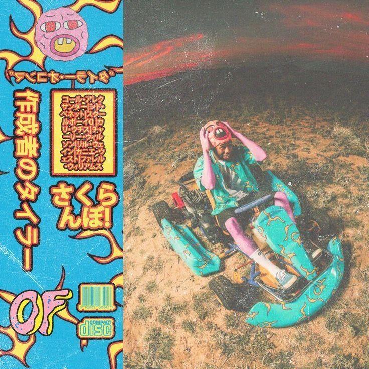

<!-- HEADER SVG ANIMADO -->

---

<table>
  <tr>
    <td></td>
    <td></td>
    <td></td>
  </tr>
</table>

---

<!-- TYPEWRITER -->

<!-- LINKS PRINCIPAIS -->

---

<!-- SOBRE MIM -->

### `SOBRE MIM`

 

---

<!-- TECNOLOGIAS -->

 ### `TECNOLOGIAS`

<kbd> <code>LINGUAGENS</code>  &nbsp;&nbsp;  &nbsp;  </kbd>
&nbsp;
<kbd> <code>FRAMEWORKS / BIBLIOTECAS</code>  &nbsp;&nbsp;  &nbsp;  </kbd>
&nbsp;
<kbd> <code>FERRAMENTAS</code>  &nbsp;&nbsp;  &nbsp;&nbsp;  </kbd>

 

---

<!-- ESTATÍSTICAS -->

### `ESTATÍSTICAS`

 

  

<!-- FOOTER SVG ANIMADO -->

